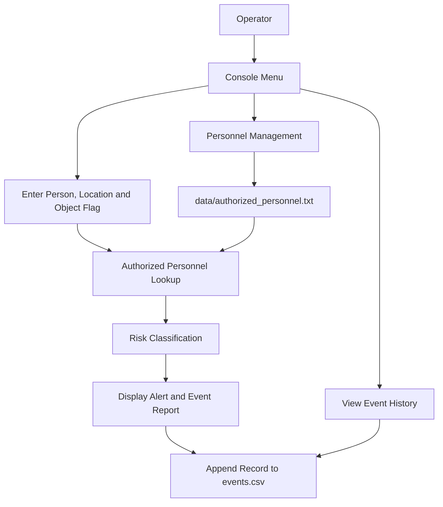
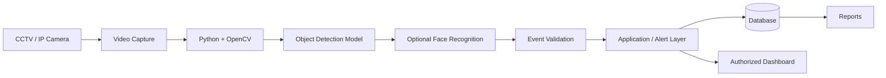

# System Architecture

## Current prototype

The current implementation is a console-based C++17 application. Event information is entered manually; there is no live camera or AI model connection.

## Proposed future AI-enabled architecture

This is a design proposal only; these components are not implemented in this repository yet.

Suggested integration boundary: the AI pipeline should produce a structured event (timestamp, camera/location, detection label, confidence, and authorized-match status). Validate model output and apply privacy/security controls before saving or displaying it.
