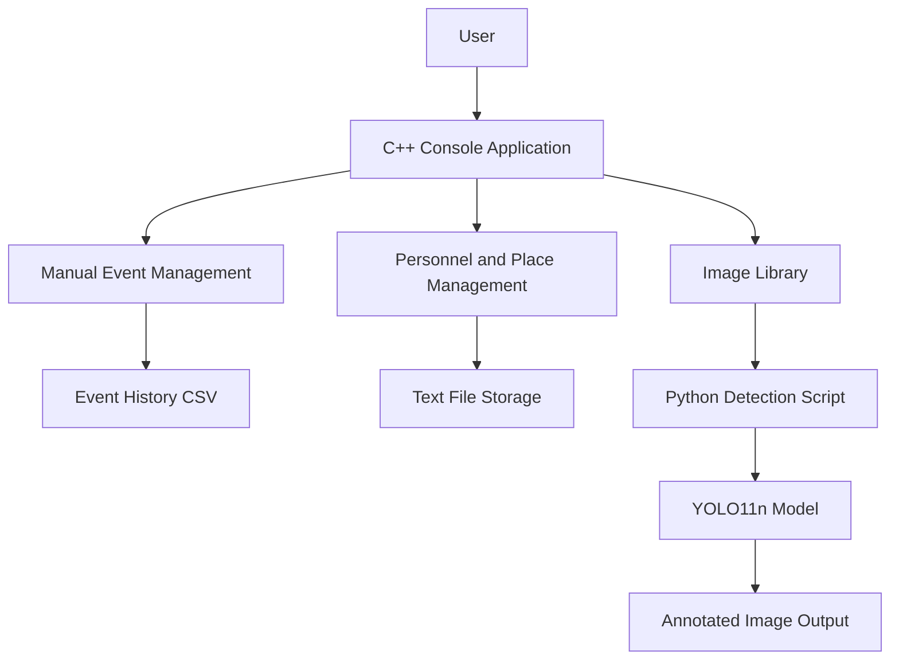

# Intelligent CCTV Surveillance System

## Current System Architecture

The project is a hybrid C++17 and Python
academic surveillance prototype.

## Components

### C++ Application
- Console-based user interface
- Personnel and place management
- Manual event recording
- Event history management
- Image library management
- Python script integration

### Python AI Module
- Ultralytics YOLO11n
- OpenCV
- Saved-image object detection
- Annotated image generation

### Data Storage
- authorized_personnel.txt
- authorized_places.txt
- events.csv
- data/images/

## Architecture Diagram

## Current Limitations

- No live CCTV camera integration.
- Object detection processes saved images.
- Manual events and AI detections are separate.
- PETALFace recognition is not implemented.
- Object detection alone cannot establish suspicious activity.

## Future Development

- Improved image detection workflow.
- Human-reviewed AI event integration.
- Database storage and reporting.
- Privacy-preserving video analysis.
- Application dashboard.
