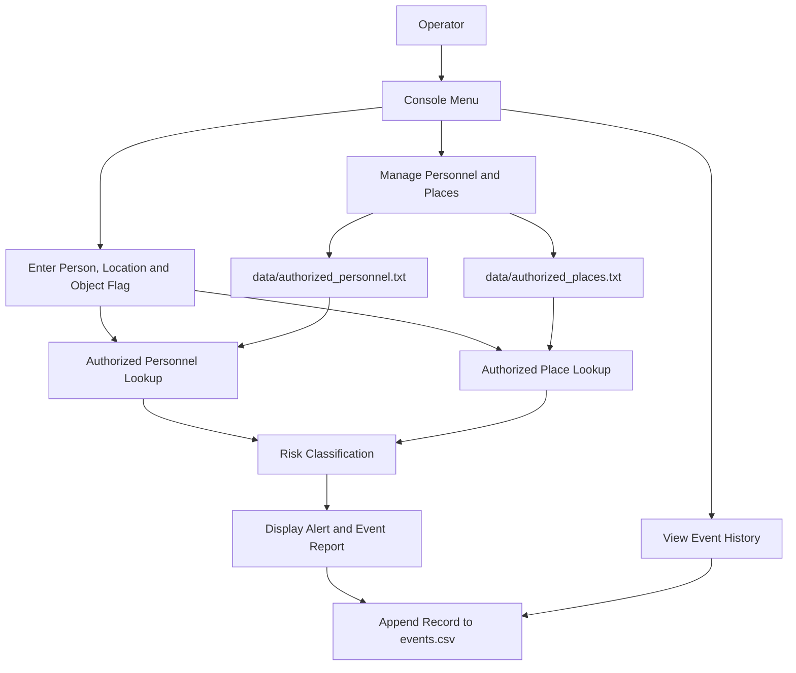
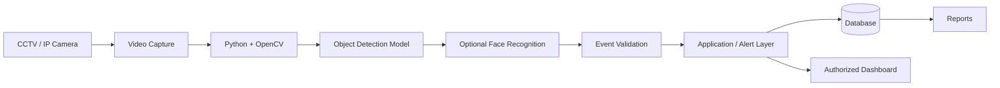

# System Architecture

## Current prototype

The current implementation is a console-based C++17 application. Event information is entered manually; there is no live camera or AI model connection.

## Proposed future AI-enabled architecture

This is a design proposal only; these components are not implemented yet. A future camera integration should map each camera to a configured location ID rather than infer a physical location from video.

